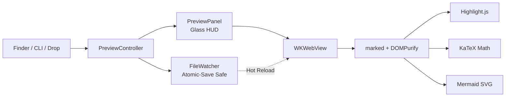

# MDReader Technical Markdown Showcase

Welcome to **MDReader v1.2.0**! Notice how the YAML frontmatter above rendered into a sleek metadata card, and try clicking the **Palette icon** in the top bar to switch between **Glass**, **GitHub**, **Sepia**, and **Nord** themes.

- [x] Offline **Mermaid.js** diagrams (lazy-loaded & theme-adaptive)
- [x] Offline **KaTeX** LaTeX math with bundled `.woff2` math fonts
- [x] **GitHub-style Alerts** (`NOTE`, `TIP`, `IMPORTANT`, `WARNING`, `CAUTION`)
- [x] **YAML Frontmatter** metadata card & custom `~/.config/mdreader/custom.css`
- [x] Persistent window size, multi-window cascading, and `⌘E` Open in Editor

---

## 🚨 GitHub-Style Alerts

> [!NOTE]
> Useful context that readers should know—even when skimming quickly.

> [!TIP]
> Press **`⌘E`** to jump straight into your code editor, or **`⌘⇧R`** to reveal this file in Finder!

> [!IMPORTANT]
> Both Mermaid and KaTeX are loaded **100% offline** on demand via `mdreader-doc://bundle/`, keeping plain Markdown startup instantaneous.

> [!WARNING]
> Opening untrusted Markdown files is safe: DOMPurify strips `<script>` tags and unsafe attributes automatically.

> [!CAUTION]
> Always test custom overrides in `~/.config/mdreader/custom.css` if you heavily restyle the header bar.

---

## 📊 Mermaid Architecture Diagram



---

## 📐 KaTeX Mathematics

Inline math works naturally inside prose—like Euler's identity $e^{i\pi} + 1 = 0$ or the quadratic roots $x = \frac{-b \pm \sqrt{b^2 - 4ac}}{2a}$—without breaking prices like \$5 or \$100.

Display equations render centered with crisp KaTeX math fonts:

$$
\int_{-\infty}^{\infty} e^{-x^2}\,dx = \sqrt{\pi}
$$

$$
\nabla \times \mathbf{E} = -\frac{\partial \mathbf{B}}{\partial t}, \qquad \sum_{n=1}^{\infty} \frac{1}{n^2} = \frac{\pi^2}{6}
$$

---

## 🔗 Smart Links & Relative Images

- **External link** (opens in default browser): [MDReader on GitHub](https://github.com/vikbht/mdreader)
- **Relative Markdown link** (opens in a cascaded MDReader window): [Open README.md](./README.md)
- **In-page anchor link**: [Jump to Code Blocks](#-code-blocks--copy-button)


<!-- Security check: DOMPurify strips this inline script safely -->
<script>window.__xssTriggered = true; document.body.innerHTML = 'XSS FAILED';</script>

---

## 💻 Code Blocks & Copy Button

### Swift
```swift
import Cocoa
import WebKit

final class PreviewPanel: NSPanel {
    func togglePin() {
        level = (level == .floating) ? .normal : .floating
    }
}
```

### Python
```python
def reading_time_minutes(text: str, wpm: int = 200) -> int:
    words = [w for w in text.split() if w]
    return max(1, round(len(words) / wpm))
```
